All ordering in the fleet lives in the level-3 Kustomizations described by [Flux topology](/architecture/flux-topology.md). They all sit in `flux-system` and name each other by plain string, so the graph is global and tier-blind: a tier decides which artifact a workload ships in, nothing more. `loki → garage` crosses tiers, and `volsync → kube-prometheus-stack` runs against the direction the old level-2 graph implied.

# A capability, not a bundle name

A consumer declares what it needs, never who provides it. `#Capability` is a closed enum and `_provider` maps each entry to exactly one bundle name, so a typo is a build error rather than a Kustomization waiting forever on a name nobody owns, and a provider can be renamed or moved tiers without touching a consumer.

| Capability            | Provider                                              | What the consumer cannot apply without it                      |
| --------------------- | ----------------------------------------------------- | -------------------------------------------------------------- |
| `ingress`             | [`traefik`](/platform/networking-and-ingress.md)      | `Middleware`                                                   |
| `certificate`         | [`cert-manager`](/platform/certificates-and-pki.md)   | `Certificate`                                                  |
| `ingress-certificate` | [`certs-config`](/platform/certificates-and-pki.md)   | the wildcard cert and intermediate CA Traefik serves           |
| `redis`               | `redis-operator`                                      | the ot-helm redis chart's CR                                   |
| `block-storage`       | [`longhorn`](/platform/storage.md)                    | `VolumeSnapshotClass`, via the Kustomizations longhorn creates |
| `postgres`            | [`cnpg`](/platform/backup-and-restore.md)             | `Cluster`, `ObjectStore`                                       |
| `volsync`             | [`volsync`](/platform/backup-and-restore.md)          | `ReplicationSource`, `ReplicationDestination`                  |
| `monitoring`          | [`kube-prometheus-stack`](/platform/observability.md) | `ServiceMonitor`, and the scrape classes one names             |
| `object-storage`      | [`garage`](/platform/storage.md)                      | the S3 endpoint                                                |
| `log-sink`            | [`loki`](/platform/observability.md)                  | the push endpoint                                              |
| `tailscale`           | `tailscale-operator`                                  | `ProxyGroup`, `ProxyClass`                                     |
| `kanidm`              | [`kanidm-operator`](/platform/identity-kanidm.md)     | `Kanidm`, and the group, person and OAuth2 client CRs          |

**A capability is something whose absence fails the apply, which in practice means a CRD.** Runtime coupling is not a capability: a PVC naming a StorageClass that does not exist yet stays `Pending` and binds later, so storage classes are deliberately absent from the enum. Declaring them would also close a cycle — `traefik`'s OIDC Redis volumes are on the default `longhorn` class, and longhorn's own bundle needs `ingress`.

# Three edges derive themselves

The three highest-fan-in capabilities are inferred from fields [`#Bundle`](/architecture/cue-layout.md) already carries and are never written:

| Field                         | Implies       |
| ----------------------------- | ------------- |
| `middlewares` (on by default) | `ingress`     |
| `namespaceCert`               | `certificate` |
| any release with `backups`    | `volsync`     |

Everything else is an explicit `needs`, because the fact lives in chart values CUE cannot introspect — it sees a HelmRelease, never what the chart renders. A `ServiceMonitor` is spelled `monitoring.metrics.serviceMonitor.enabled` in garage, `monitoring.enabled` in opencloud, and a `.Capabilities` gate in volsync's chart; there is no uniform field to read.

A provider needing its own capability is filtered in `#Tier.sync`, which is the only place a bundle's own name is known — `bundles` is keyed by it.

# The graph

Each arrow runs from consumer to provider and carries the capability that put it there; a subgraph is a tier, which orders nothing. `cue/graph` builds the block from the same `edges` `#Tier.sync` renders into `dependsOn`, and the `capability-graph` pre-commit hook splices it in, so it cannot drift from the rendered manifests. It shows a cycle but does not detect one.

<!-- capability-graph:begin -->

30 bundles, 38 edges.

```mermaid
flowchart BT
  subgraph tier_controllers["infrastructure/controllers"]
    cert_manager["cert-manager"]
    certs_config["certs-config"]
    cnpg["cnpg"]
    cnpg_config["cnpg-config"]
    longhorn["longhorn"]
    longhorn_config["longhorn-config"]
    redis_operator["redis-operator"]
    reflector["reflector"]
    reloader["reloader"]
    tailscale_config["tailscale-config"]
    tailscale_operator["tailscale-operator"]
    traefik["traefik"]
    volsync["volsync"]
  end
  subgraph tier_plugins["infrastructure/plugins"]
    generic_device_plugin["generic-device-plugin"]
    nvidia_device_plugin["nvidia-device-plugin"]
  end
  subgraph tier_storage["infrastructure/storage"]
    garage["garage"]
  end
  subgraph tier_security["infrastructure/security"]
    kanidm_cluster["kanidm-cluster"]
    kanidm_operator["kanidm-operator"]
  end
  subgraph tier_observability["infrastructure/observability"]
    alloy["alloy"]
    gotify["gotify"]
    grafana["grafana"]
    kube_prometheus_stack["kube-prometheus-stack"]
    loki["loki"]
  end
  subgraph tier_cloud["apps/cloud"]
    opencloud["opencloud"]
  end
  subgraph tier_media["apps/media"]
    audiobookshelf["audiobookshelf"]
    jellyfin["jellyfin"]
    jellyseerr["jellyseerr"]
    komga["komga"]
    qbittorrent["qbittorrent"]
    servarr["servarr"]
  end
  alloy -->|log-sink| loki
  audiobookshelf -->|ingress| traefik
  audiobookshelf -->|volsync| volsync
  certs_config -->|certificate| cert_manager
  cnpg_config -->|postgres| cnpg
  garage -->|ingress| traefik
  garage -->|monitoring| kube_prometheus_stack
  gotify -->|ingress| traefik
  gotify -->|kanidm| kanidm_operator
  gotify -->|monitoring| kube_prometheus_stack
  gotify -->|postgres| cnpg
  gotify -->|volsync| volsync
  grafana -->|ingress| traefik
  grafana -->|kanidm| kanidm_operator
  grafana -->|monitoring| kube_prometheus_stack
  jellyfin -->|ingress| traefik
  jellyfin -->|volsync| volsync
  jellyseerr -->|ingress| traefik
  jellyseerr -->|volsync| volsync
  kanidm_cluster -->|certificate| cert_manager
  kanidm_cluster -->|ingress| traefik
  kanidm_cluster -->|kanidm| kanidm_operator
  kanidm_cluster -->|volsync| volsync
  kanidm_operator -->|ingress| traefik
  komga -->|ingress| traefik
  komga -->|volsync| volsync
  loki -->|object-storage| garage
  longhorn_config -->|block-storage| longhorn
  opencloud -->|ingress| traefik
  opencloud -->|monitoring| kube_prometheus_stack
  qbittorrent -->|volsync| volsync
  servarr -->|ingress| traefik
  servarr -->|postgres| cnpg
  tailscale_config -->|tailscale| tailscale_operator
  traefik -->|ingress-certificate| certs_config
  traefik -->|monitoring| kube_prometheus_stack
  traefik -->|redis| redis_operator
  volsync -->|monitoring| kube_prometheus_stack
```



<!-- capability-graph:end -->

The chain that sets the depth: `cert-manager → certs-config → traefik → garage → loki → alloy`.

`traefik`, two hops from a root, is the fleet's articulation point: 11 bundles reach it through `ingress` alone, and every bundle deeper than it is behind it. It was 14 before the operational ingresses moved to [the tailnet](/platform/networking-and-ingress.md), which declares no capability at all — and the same move is why `longhorn` is now a root. Its depth survived the [MetalLB removal](/platform/networking-and-ingress.md): it was never the address pool, it is `cert-manager → certs-config`.

Level-3 Kustomizations carry `retryInterval: "1m"` against a 10m `interval`. Without it a blocked reconcile retries at the interval, so a five-hop chain costs fifty minutes of waiting rather than five.

`timeout` is the ceiling on the health assessment and defaults to 5m, or 15m where the bundle waits. Two bundles need more: `certs-config` takes 40m because ACME validates the apex and the wildcard sequentially, and `longhorn` 35m to stay above its own release timeout while a DaemonSet rolls across four nodes.

# What an edge means

**Every provider sets `wait: true`, so an edge to one of them means its chart is installed and its pods are up.** `disableWait` defaults to false, so helm-controller has already waited for the chart's resources before the HelmRelease goes Ready, and a bundle's inventory is just the Namespace, its sources, its HelmReleases and its Middleware set — assessing that inventory is therefore the gate a consumer wants, for one boolean. It also closes the webhook race that a plain edge never could: six admission webhooks are live, and applying a `Certificate` or `Cluster` against one with no endpoints fails.

`certs-config` waits on its whole inventory rather than on named objects — root CA cert and Issuer, intermediate cert and ClusterIssuer, the ACME ClusterIssuer and the wildcard all carry a real `Ready`.

**The fleet uses no `healthChecks`.** Flux ignores them when `wait` is set, and `wait` covers strictly more, so a second mechanism would only invite a bundle to declare both. `healthCheckExprs` — CEL per GVK, evaluated under `wait` — is the escape hatch for a CR whose conditions kstatus cannot read, and is deliberately unused. Two objects qualify: the trust-manager `Bundle`, whose status carries only `Synced`, and the `ProxyGroup`, whose status carries `conditions`, `devices` and `url` — neither has a top-level `observedGeneration` or a `Reconciling`/`Stalled` condition. Its CA reaches kanidm-system and opencloud as a reflector-copied Secret, so a missing one leaves a pod in `ContainerCreating` rather than failing an apply — [runtime coupling](/platform/certificates-and-pki.md), the same category as a StorageClass.

`wait: true` is never set on an app. A gate on a leaf helps nobody, and cnpg's `Cluster` carries a real `Ready` — so waiting on servarr would mean waiting on a barman restore.

**An edge to a config bundle still only means "applied".** `longhorn-config → longhorn` used to show that limit; it no longer does, because waiting on longhorn also assesses the two `snapshot-crds`/`snapshot-controller` Kustomizations in its `after`, which is where the `VolumeSnapshotClass` CRD comes from. What remains applied-only is every edge between apps. `tailscale-config` waits, but on a `ProxyGroup` kstatus most likely cannot read.

A `no matches for kind` message therefore still happens, and it outlives its cause: kustomize-controller's discovery cache keeps failing the dry-run for a while after the CRD is established, so the fix is a reconcile rather than more waiting. Compare the CRD's `creationTimestamp` with the condition's `lastTransitionTime` before believing the message.

Forcing the whole set is one command, and repeating it walks the graph as fast as the CRDs establish:

```sh
kubectl annotate kustomization -n flux-system --all \
  reconcile.fluxcd.io/requestedAt="$(date +%s)" --overwrite
```

# Traps

- **A `wait` on a bundle whose inventory holds a CR kstatus cannot read is unproven.** kstatus assesses a custom resource generically: top-level `observedGeneration`, then `Reconciling`/`Stalled`. An object with none of those — the trust-manager `Bundle` and the `ProxyGroup` — depends on what that fallback does with nothing to read, and it has not been observed here either way. `tailscale-config` is the first bundle to wait on such a CR, so it is where this gets settled: the expectation is that the fallback reports `Current` immediately, making the gate weak rather than hanging. If a waiting bundle ever sits `Progressing` with every named object Ready, that is the cause, and the fix is a `healthCheckExprs` entry for the GVK rather than dropping the wait.
- **Nothing detects a cycle.** Whether kustomize-controller reports one or merely stalls every node in it is unverified, and CUE will not catch it either — `_provider` is a flat map, and the graph only exists once rendered. A new `needs` is therefore checked by topologically sorting the rendered `sync/*-sync.yaml`, not by `cue vet`. This document is the guard.
- **Three near-misses are live, all on kube-prometheus-stack.** It needs nothing, which is what lets any bundle need `monitoring`, and anything it comes to need closes a cycle back through one of those bundles. `traefik → kube-prometheus-stack` means it must never need `ingress` — a public UI there would need the middleware set, which is why `middlewares: false` is load-bearing on it — `garage → kube-prometheus-stack` means it must never need `object-storage` — putting Thanos on Garage would close it — and `kanidm-cluster → volsync → kube-prometheus-stack` means it must never need `kanidm`, which is why Grafana is [its own bundle](/platform/observability.md). The same holds at runtime, where no edge shows it: a pod in kube-prometheus-stack waiting on a Secret kaniop writes would deadlock a cold start behind its own `wait`. The default StorageClass must not become a capability either: traefik is a storage consumer, so it would need longhorn, and longhorn needs traefik the moment it serves an ingress through Traefik again.
- **A capability with two providers is not expressible.** One name, one bundle. Two bundles providing the same CRD would need the consumers to pick, which the enum deliberately does not allow.
- **Adding a capability to `#Bundle`'s inferred set adds edges everywhere at once.** `middlewares` is on by default, so a bundle acquires the `ingress` edge by saying nothing. All 10 reference the set they install today, but that is a property of the fleet rather than of the schema, and the edge would be real either way because the CR is applied.
